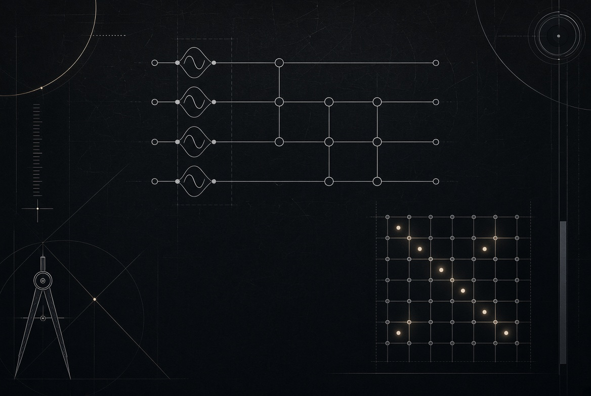

# Q-ATTN-01



A classical Transformer decides which tokens matter by a dot product. Q-ATTN-01 decides by the fidelity of two quantum states.

Each token embedding is encoded into a 4-qubit register. Four `Ry` rotations load the features. A CNOT chain entangles them. The attention score between token `i` and token `j` is the overlap of the two resulting states:

```
s_ij = |⟨q_i | q_j⟩|²
```

Those scores are softened and normalized, then used to mix classical value vectors. The circuit is quantum. The aggregation is classical. The whole thing is a hybrid.

```
θ_i = embedding[i] · π
|q⟩ = Ry(θ) × 4, then CNOT(0,1), CNOT(1,2), CNOT(2,3)
a_ij = exp(β · s_ij) / Σ_k exp(β · s_ik)
y_i  = Σ_j a_ij · value_j
```

Qubit 0 is the least significant bit. The statevector is 16 amplitudes. That is the entire feature map. It is small on purpose: small enough to simulate exactly, small enough to check by hand, small enough to run on an RTX 3080 without pretending to be a fault-tolerant machine.

## Why the entropy is separate

ANU's quantum random number generator measures vacuum fluctuations. NIST's beacon publishes a signed public pulse. Both are real sources of randomness. Neither is a quantum computer.

Q-ATTN-01 treats them that way. Entropy can perturb an angle or seed an experiment. It does not execute a gate. The runtime labels every sample: `anu_modern`, `anu_legacy`, `nist_beacon`, or `os_crypto`. Calling ANU does not run the feature circuit. The feature circuit does not claim to be a QPU.

That separation is the point. Quantum attention is a circuit. Quantum entropy is a number. Mixing the two up is how projects start lying about what they did.

## What runs

The production tree is native. C++20 owns the entrypoint, the statevector, the attention, and the entropy client. CUDA kernels implement the same gates on the GPU. ArrayFire owns the device arrays when it is present. CUDA-Q defines the same circuit in `__qpu__` when it is present. A CPU reference always exists so the math can be checked without a GPU.

Python is not on this path. Earlier prototypes remain in git history under `archive/python/`. They are provenance, not the runtime.

```
cuda_arrayfire/
  src/            CPU reference, attention, entropy, main
  cuda/           Ry, CNOT, fidelity kernels (sm_86)
  arrayfire/      ArrayFire host, built only if found
  cudaq/          CUDA-Q feature circuit and Bell circuit
  include/qattn/  headers
  tests/          CPU reference tests
```

## Build

```bash
cd cuda_arrayfire
g++ -std=c++20 -Iinclude -o qattn_runtime \
    src/main.cpp src/statevector.cpp src/attention.cpp src/entropy.cpp
./qattn_runtime
```

Or with CMake, which turns on CUDA, ArrayFire, and CUDA-Q only when it finds them:

```bash
cmake -S . -B build && cmake --build build && ctest --test-dir build
```

Live ANU and NIST need libcurl at build time. The modern ANU endpoint needs `ANU_API_KEY` in the environment. The key is never stored in the tree.

## License

SnapKitty Opaque AGPL-3.0  
Copyright (C) 2026 Bel Esprit D'Accord Irrevocable Trust / SnapKitty Collective  
SnapKitty Research Lab — Ahmad Ali Parr, Jessica Westerhoff
